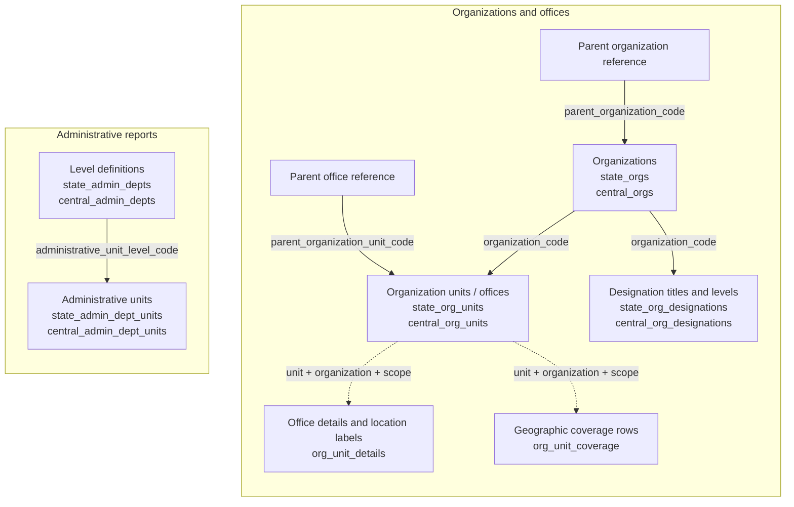
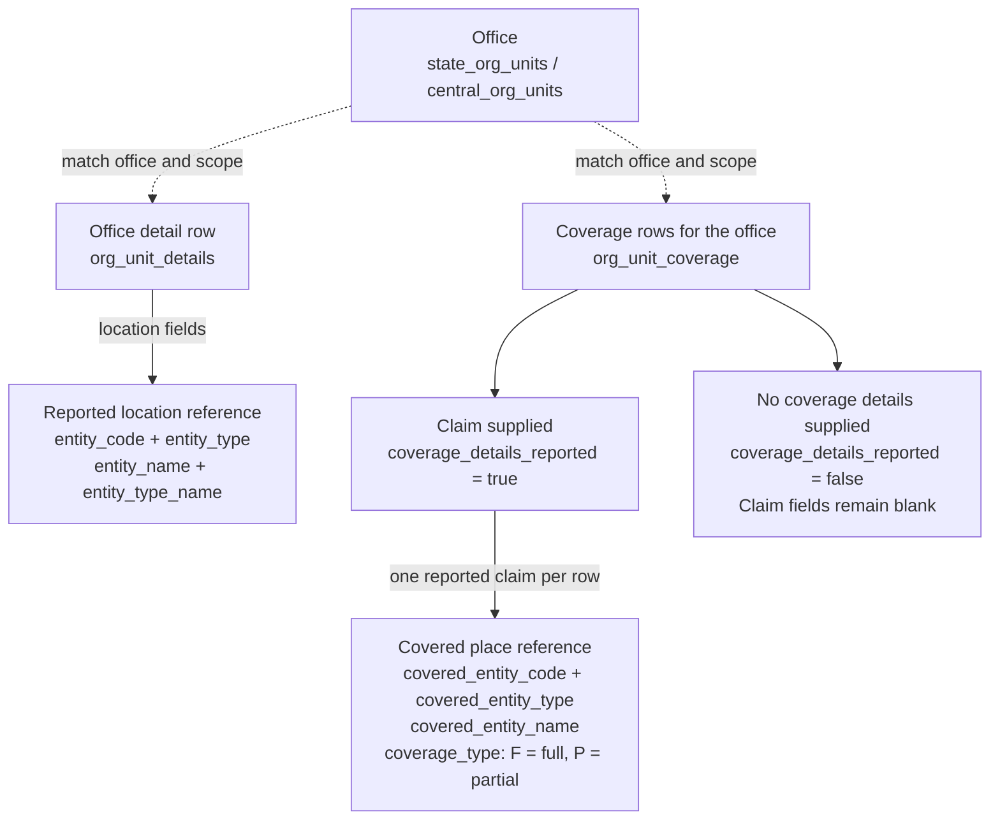
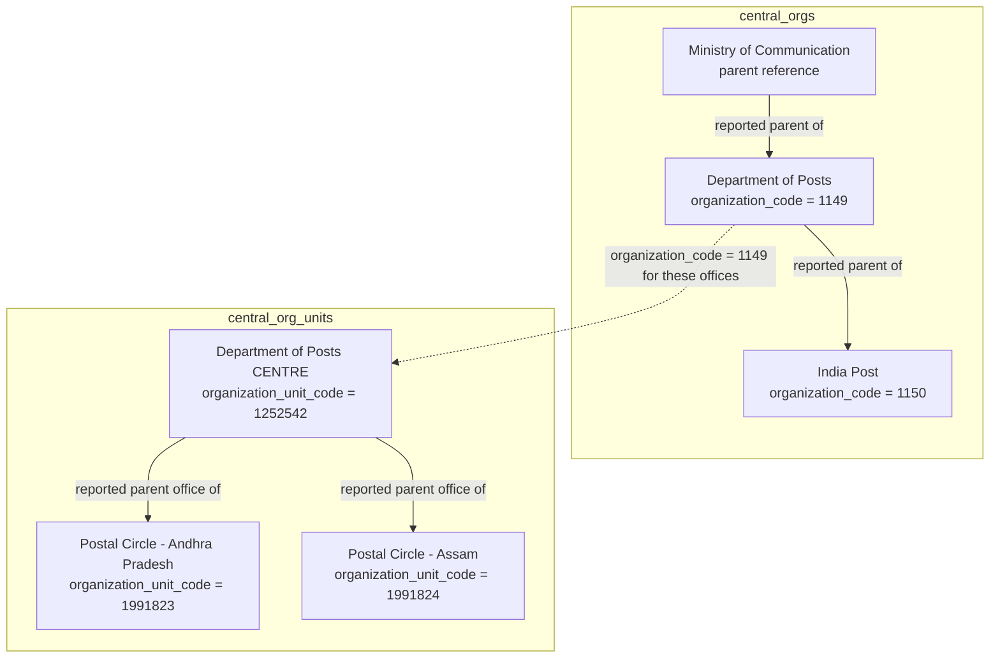
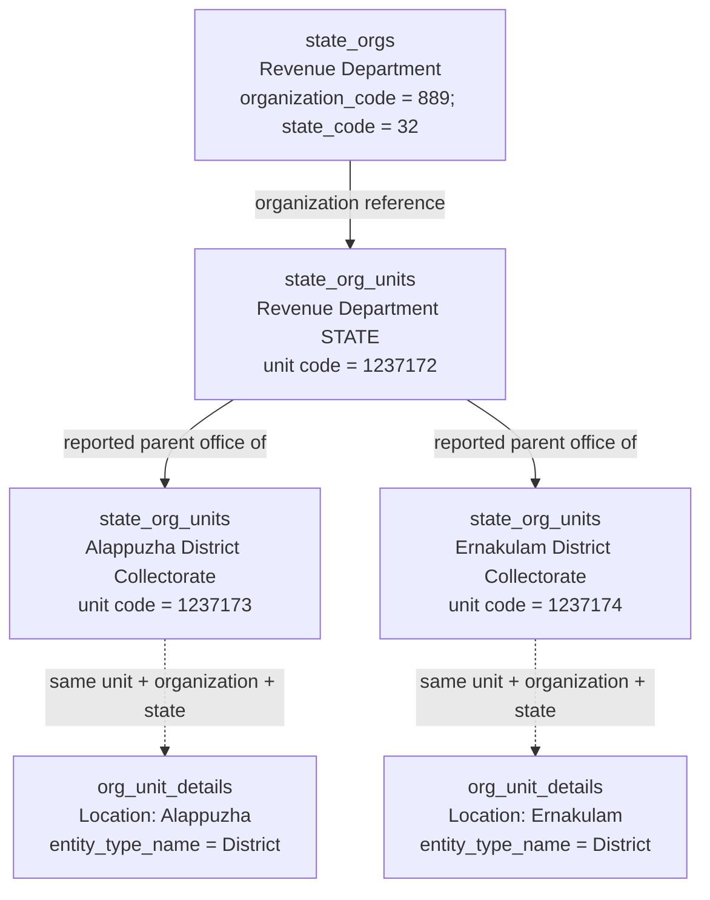

# Organization data model

The organization data describes departments, their offices, reported parent
relationships, designation titles and geographic references. Twelve reports
cover these concepts. This guide shows which dataset supplies each part and
which joins the query helpers use. For commands and API results, use the
[query cookbook](ORGANIZATION_QUERIES.md).

The dataset-aware query APIs and CLI commands described here are
[experimental](QUERIES.md#experimental-status); their interfaces and interpretation
of relationships may change as we learn more about LGD's reports.

The diagrams describe reported references and query dependencies. They do not
assert that every parent exists, every office appears in every report, or every
reference is a verified foreign key. Multiple records and source variants remain
visible. See [query conventions](QUERIES.md) for dates, filtering and matching.

## What LGD means by levels and units

The official [LGD user manual](https://panchayat.gov.in/en/document/lgd_updated_manual/)
(version 6.0, dated 3 April 2017) explains the concepts through its entry forms:

- **Administrative unit level:** a named definition with parent levels; several
  parents can be selected ([pages 998–1000](https://cdnbbsr.s3waas.gov.in/s316026d60ff9b54410b3435b403afd226/uploads/2023/02/2023022726.pdf#page=998)).
- **Administrative unit entity:** a named member with a selected type, parent
  and coverage ([pages 1011–1014](https://cdnbbsr.s3waas.gov.in/s316026d60ff9b54410b3435b403afd226/uploads/2023/02/2023022726.pdf#page=1011)).
- **Organization hierarchy:** configured before creating offices; its locations
  can use districts, subdistricts, blocks, villages or custom administrative
  levels ([pages 1034–1035](https://cdnbbsr.s3waas.gov.in/s316026d60ff9b54410b3435b403afd226/uploads/2023/02/2023022726.pdf#page=1034)).
- **Organization unit:** the particular office. The address form selects an
  organization, then its level, then a unit ([page 1090](https://cdnbbsr.s3waas.gov.in/s316026d60ff9b54410b3435b403afd226/uploads/2023/02/2023022726.pdf#page=1090)).

Our interpretation of these concepts maps administrative levels to
`*_admin_depts`, their members to `*_admin_dept_units`, and offices to
`*_org_units`. An office's `organization_level_code` and its location's
`entity_type` therefore describe different references. The cited sections
explain the model; they do not establish today's export keys or a complete
numeric type enumeration. The key reviews and supplied type labels below
provide that separate evidence.

## Which files contain which data

Each dataset name below is also the base name of its source CSV and standalone
Parquet file: for example, `central_orgs.csv` becomes the `central_orgs` Parquet
dataset. Release asset names additionally contain dates or publication identifiers;
resolve them through the release metadata instead of constructing download URLs.

| Concept | Dataset and query API | Source schema | Main identifier |
| --- | --- | --- | --- |
| State organizations and parent organizations | [state_orgs](datasets/state_orgs.md) | [CSV → Parquet fields](../../lgd/parquet/datasets/state_orgs.md) | `organization_code`; state is an attribute |
| Central organizations and parent organizations | [central_orgs](datasets/central_orgs.md) | [CSV → Parquet fields](../../lgd/parquet/datasets/central_orgs.md) | `organization_code` |
| State offices, parent offices and location codes | [state_org_units](datasets/state_org_units.md) | [CSV → Parquet fields](../../lgd/parquet/datasets/state_org_units.md) | `organization_unit_code`; organization and state are attributes |
| Central offices, parent offices and location codes | [central_org_units](datasets/central_org_units.md) | [CSV → Parquet fields](../../lgd/parquet/datasets/central_org_units.md) | `organization_unit_code`; organization is an attribute |
| State designation titles and named levels | [state_org_designations](datasets/state_org_designations.md) | [CSV → Parquet fields](../../lgd/parquet/datasets/state_org_designations.md) | `designation_code` + `organization_level_code` + `organization_level_name` |
| Central designation titles and named levels | [central_org_designations](datasets/central_org_designations.md) | [CSV → Parquet fields](../../lgd/parquet/datasets/central_org_designations.md) | `designation_code` + `organization_level_code` + `organization_level_name` |
| State administrative level definitions | [state_admin_depts](datasets/state_admin_depts.md) | [CSV → Parquet fields](../../lgd/parquet/datasets/state_admin_depts.md) | `administrative_unit_level_code`; state is an attribute |
| Central administrative level definitions | [central_admin_depts](datasets/central_admin_depts.md) | [CSV → Parquet fields](../../lgd/parquet/datasets/central_admin_depts.md) | `administrative_unit_level_code` |
| State administrative units and their levels | [state_admin_dept_units](datasets/state_admin_dept_units.md) | [CSV → Parquet fields](../../lgd/parquet/datasets/state_admin_dept_units.md) | `administrative_unit_code`; level and state are attributes |
| Central administrative units and their levels | [central_admin_dept_units](datasets/central_admin_dept_units.md) | [CSV → Parquet fields](../../lgd/parquet/datasets/central_admin_dept_units.md) | `administrative_unit_code`; level is an attribute |
| Office details: address, contact fields, location labels and parent office | [org_unit_details](datasets/org_unit_details.md) | [CSV → Parquet fields](../../lgd/parquet/datasets/org_unit_details.md) | `organization_unit_code`; organization and state/Centre scope are attributes |
| Reported geographic coverage of offices | [org_unit_coverage](datasets/org_unit_coverage.md) | [CSV → Parquet fields](../../lgd/parquet/datasets/org_unit_coverage.md) | `organization_unit_code`, `covered_entity_type`, `covered_entity_code` |

The `central_*` reports have no state column. The combined details and coverage
reports use `state_code='0'` for central organizations. That is the organization
report scope, not a geographic state to assign to every covered place.

## How the reports relate

Solid arrows below denote references carried in the source reports. Dashed
arrows connect reports about the same office using codes and scope; matching
rows may be absent. These are conceptual relationships, not mandatory SQL joins
performed by every API call.

An `organization_code` identifies an organization; an
`organization_unit_code` identifies an office/unit in its directory.
`administrative_unit_code` belongs to a separately reported namespace. Similar
names, or even equal numbers, do not establish equality between these identifiers.
State and organization scope must accompany joins where those fields apply.

Despite the filename, `*_admin_depts` contains **administrative level
definitions**, including Region, Division and Branch Post Office. The
designation reports describe titles such as Postmaster and their reported
levels; they do not identify the person holding a post or assign that person
to an individual office.

## Location and coverage have different sources

The office directory supplies location codes. The details report supplies a
location name/type label, while the coverage report describes the targets of
individual coverage claims. The diagram is schematic; it does not assert
coverage for any particular office.

An office can have several coverage rows and cover different kinds of places.
An untyped numeric target code cannot safely be joined to a village, district
or local-body dataset. Missing target types remain unresolved. The coverage
report's own `entity_code` / `entity_name` fields describe the office's location
reference; **`covered_entity_*` identifies the coverage target**. That report
does not supply the type of its location reference.

`coverage_details_reported='false'` means that coverage details were not supplied.
It does not establish that the office covers no places. Neither a missing row
nor the absence of a coverage claim establishes that an office was deleted.

## Real examples from the 23 October 2026 reports

These examples were read from generation
`2026-10-23T162124Z.13371c752398`. Labels below shorten the supplied office names
for readability; query results retain the source text. The examples illustrate
particular reported rows, not complete organization charts.

### Organizations and postal offices

The organization-to-parent relationships come from `central_orgs`. The office
hierarchy comes from `central_org_units`. The Ministry name below was read as
the Department's parent reference; this example does not require a separate
Ministry row.

`central_org_designations` supplies a different part of this picture:

| Organization | Reported designation | Reported level name |
| --- | --- | --- |
| Department of Posts | Superintendent of Post Offices | Postal Division |
| Department of Posts | Postmaster | Postal Head Office |
| Department of Posts | Sub Postmaster | Postal Sub Office |
| Department of Posts | Branch Postmaster | Postal Branch Office |

`central_admin_dept_units` also reports **Surauli Branch Post Office**
(`administrative_unit_code='100001'`) under the **Branch Post Office** level.
That administrative-unit code does not, by itself, identify a row in
`central_org_units`.

### Kerala Revenue Department and its collectorates

The organization record is from `state_orgs`; the office and parent-office
references are from `state_org_units`. The district location labels are from
`org_unit_details`, matched using unit, organization and state codes.

The query for reported coverage claims under Kerala's Revenue Department returned
no rows in this snapshot. The location links above therefore must not be presented
as verified coverage claims.
