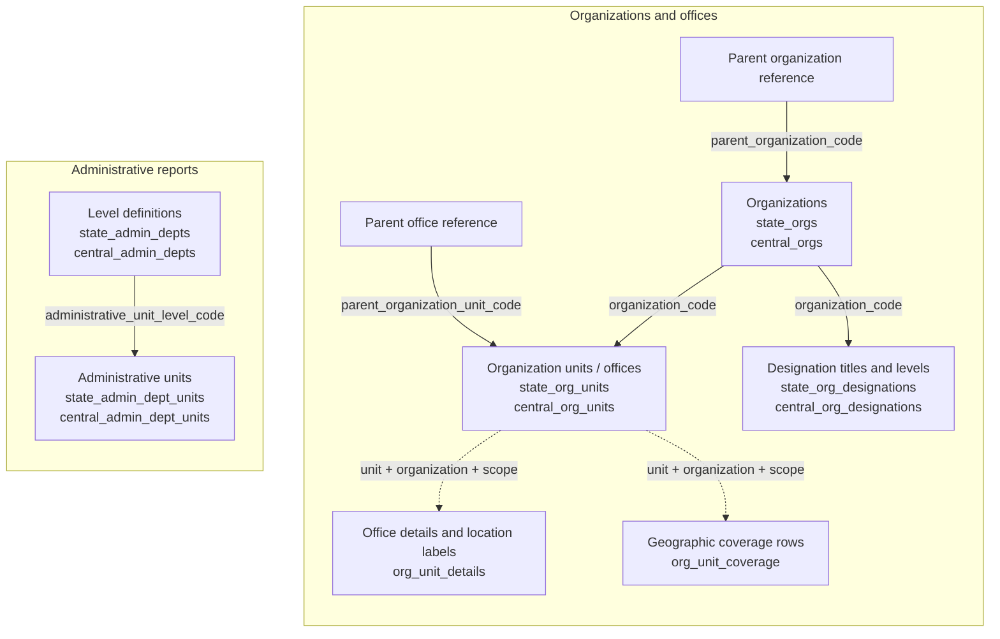
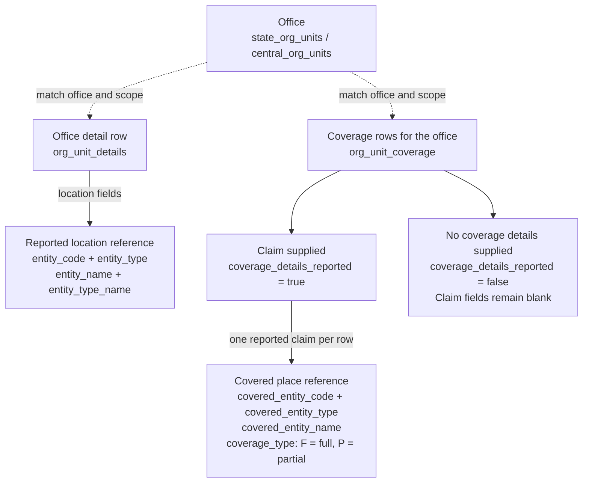
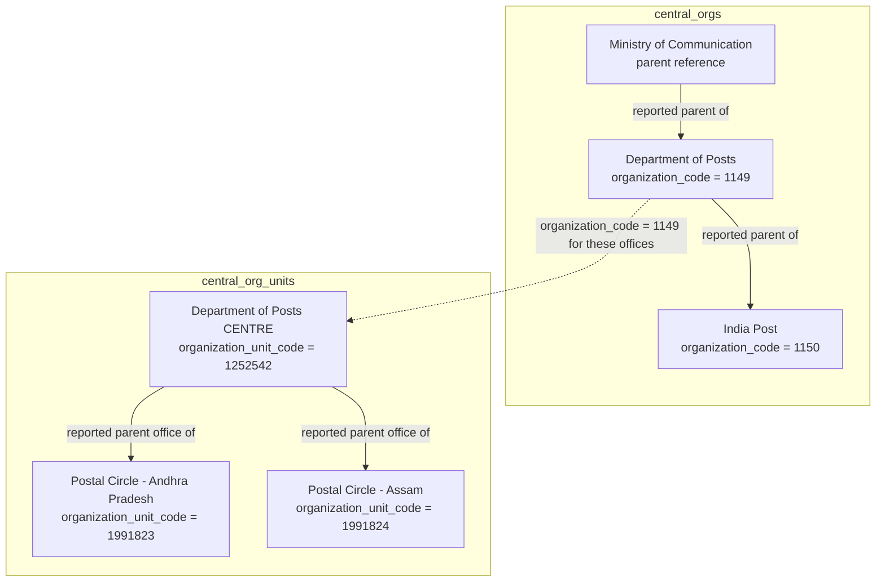
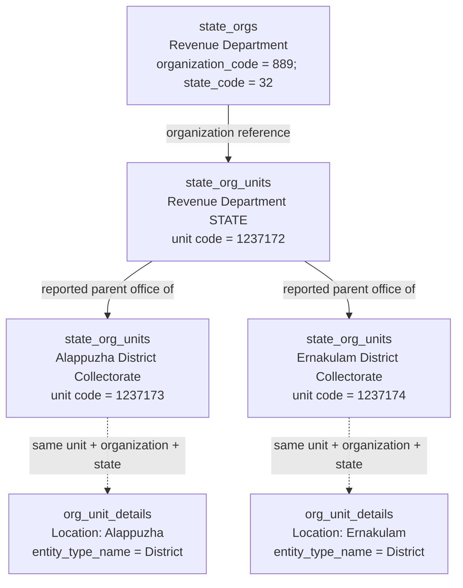
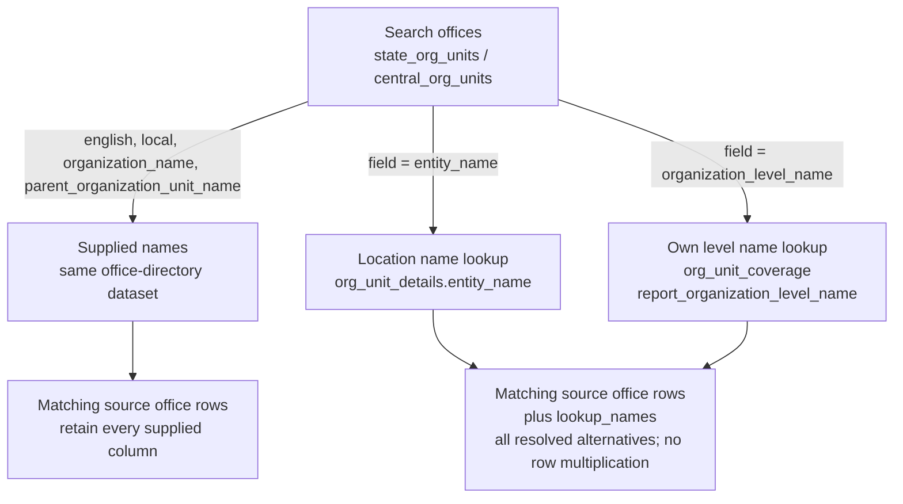

# Organization data and its sources

The organization data describes departments, their offices, reported parent
relationships, designation titles and geographic references. Twelve reports
cover these concepts. This guide shows which dataset supplies each part and
which joins the query helpers use.

The dataset-aware query APIs and CLI commands described here are
[experimental](QUERIES.md#experimental-status); their interfaces and interpretation
of relationships may change as we learn more about LGD's reports.

The diagrams describe reported references and query dependencies. They do not
assert that every parent exists, every office appears in every report, or every
reference is a verified foreign key. Multiple records and source variants remain
visible. See [query conventions](QUERIES.md) for dates, filtering and matching.

## What LGD means by levels and units

The official [LGD user manual](https://panchayat.gov.in/en/document/lgd_updated_manual/)
(version 6.0, dated 3 April 2017) explains the concepts through its entry forms:

- **Administrative unit level:** a named definition with parent levels; several
  parents can be selected ([pages 998–1000](https://cdnbbsr.s3waas.gov.in/s316026d60ff9b54410b3435b403afd226/uploads/2023/02/2023022726.pdf#page=998)).
- **Administrative unit entity:** a named member with a selected type, parent
  and coverage ([pages 1011–1014](https://cdnbbsr.s3waas.gov.in/s316026d60ff9b54410b3435b403afd226/uploads/2023/02/2023022726.pdf#page=1011)).
- **Organization hierarchy:** configured before creating offices; its locations
  can use districts, subdistricts, blocks, villages or custom administrative
  levels ([pages 1034–1035](https://cdnbbsr.s3waas.gov.in/s316026d60ff9b54410b3435b403afd226/uploads/2023/02/2023022726.pdf#page=1034)).
- **Organization unit:** the particular office. The address form selects an
  organization, then its level, then a unit ([page 1090](https://cdnbbsr.s3waas.gov.in/s316026d60ff9b54410b3435b403afd226/uploads/2023/02/2023022726.pdf#page=1090)).

Our interpretation of these concepts maps administrative levels to
`*_admin_depts`, their members to `*_admin_dept_units`, and offices to
`*_org_units`. An office's `organization_level_code` and its location's
`entity_type` therefore describe different references. The cited sections
explain the model; they do not establish today's export keys or a complete
numeric type enumeration. The key reviews and supplied type labels below
provide that separate evidence.

## Which files contain which data

Each dataset name below is also the base name of its source CSV and standalone
Parquet file: for example, `central_orgs.csv` becomes the `central_orgs` Parquet
dataset. Release asset names additionally contain dates or publication identifiers;
resolve them through the release metadata instead of constructing download URLs.

| Concept | Dataset and query API | Source schema | Main identifier |
| --- | --- | --- | --- |
| State organizations and parent organizations | [state_orgs](datasets/state_orgs.md) | [CSV → Parquet fields](../../lgd/parquet/datasets/state_orgs.md) | `organization_code`; state is an attribute |
| Central organizations and parent organizations | [central_orgs](datasets/central_orgs.md) | [CSV → Parquet fields](../../lgd/parquet/datasets/central_orgs.md) | `organization_code` |
| State offices, parent offices and location codes | [state_org_units](datasets/state_org_units.md) | [CSV → Parquet fields](../../lgd/parquet/datasets/state_org_units.md) | `organization_unit_code`; organization and state are attributes |
| Central offices, parent offices and location codes | [central_org_units](datasets/central_org_units.md) | [CSV → Parquet fields](../../lgd/parquet/datasets/central_org_units.md) | `organization_unit_code`; organization is an attribute |
| State designation titles and named levels | [state_org_designations](datasets/state_org_designations.md) | [CSV → Parquet fields](../../lgd/parquet/datasets/state_org_designations.md) | `designation_code` + `organization_level_code` + `organization_level_name` |
| Central designation titles and named levels | [central_org_designations](datasets/central_org_designations.md) | [CSV → Parquet fields](../../lgd/parquet/datasets/central_org_designations.md) | `designation_code` + `organization_level_code` + `organization_level_name` |
| State administrative level definitions | [state_admin_depts](datasets/state_admin_depts.md) | [CSV → Parquet fields](../../lgd/parquet/datasets/state_admin_depts.md) | `administrative_unit_level_code`; state is an attribute |
| Central administrative level definitions | [central_admin_depts](datasets/central_admin_depts.md) | [CSV → Parquet fields](../../lgd/parquet/datasets/central_admin_depts.md) | `administrative_unit_level_code` |
| State administrative units and their levels | [state_admin_dept_units](datasets/state_admin_dept_units.md) | [CSV → Parquet fields](../../lgd/parquet/datasets/state_admin_dept_units.md) | `administrative_unit_code`; level and state are attributes |
| Central administrative units and their levels | [central_admin_dept_units](datasets/central_admin_dept_units.md) | [CSV → Parquet fields](../../lgd/parquet/datasets/central_admin_dept_units.md) | `administrative_unit_code`; level is an attribute |
| Office details: address, contact fields, location labels and parent office | [org_unit_details](datasets/org_unit_details.md) | [CSV → Parquet fields](../../lgd/parquet/datasets/org_unit_details.md) | `organization_unit_code`; organization and state/Centre scope are attributes |
| Reported geographic coverage of offices | [org_unit_coverage](datasets/org_unit_coverage.md) | [CSV → Parquet fields](../../lgd/parquet/datasets/org_unit_coverage.md) | `organization_unit_code`, `covered_entity_type`, `covered_entity_code` |

The `central_*` reports have no state column. The combined details and coverage
reports use `state_code='0'` for central organizations. That is the organization
report scope, not a geographic state to assign to every covered place.

## How the reports relate

Solid arrows below denote references carried in the source reports. Dashed
arrows connect reports about the same office using codes and scope; matching
rows may be absent. These are conceptual relationships, not mandatory SQL joins
performed by every API call.



An `organization_code` identifies an organization; an
`organization_unit_code` identifies an office/unit in its directory.
`administrative_unit_code` belongs to a separately reported namespace. Similar
names, or even equal numbers, do not establish equality between these identifiers.
State and organization scope must accompany joins where those fields apply.

Despite the filename, `*_admin_depts` contains **administrative level
definitions**, including Region, Division and Branch Post Office. The
designation reports describe titles such as Postmaster and their reported
levels; they do not identify the person holding a post or assign that person
to an individual office.

## Location and coverage have different sources

The office directory supplies location codes. The details report supplies a
location name/type label, while the coverage report describes the targets of
individual coverage claims. The diagram is schematic; it does not assert
coverage for any particular office.



An office can have several coverage rows and cover different kinds of places.
An untyped numeric target code cannot safely be joined to a village, district
or local-body dataset. Missing target types remain unresolved. The coverage
report's own `entity_code` / `entity_name` fields describe the office's location
reference; **`covered_entity_*` identifies the coverage target**. That report
does not supply the type of its location reference.

`coverage_details_reported='false'` means that coverage details were not supplied.
It does not establish that the office covers no places. Neither a missing row
nor the absence of a coverage claim establishes that an office was deleted.

## Real examples from the 23 October 2026 reports

These examples were read from generation
`2026-10-23T162124Z.13371c752398`. Labels below shorten the supplied office names
for readability; query results retain the source text. The examples illustrate
particular reported rows, not complete organization charts.

### Organizations and postal offices

The organization-to-parent relationships come from `central_orgs`. The office
hierarchy comes from `central_org_units`. The Ministry name below was read as
the Department's parent reference; this example does not require a separate
Ministry row.



`central_org_designations` supplies a different part of this picture:

| Organization | Reported designation | Reported level name |
| --- | --- | --- |
| Department of Posts | Superintendent of Post Offices | Postal Division |
| Department of Posts | Postmaster | Postal Head Office |
| Department of Posts | Sub Postmaster | Postal Sub Office |
| Department of Posts | Branch Postmaster | Postal Branch Office |

`central_admin_dept_units` also reports **Surauli Branch Post Office**
(`administrative_unit_code='100001'`) under the **Branch Post Office** level.
That administrative-unit code does not, by itself, identify a row in
`central_org_units`.

### Kerala Revenue Department and its collectorates

The organization record is from `state_orgs`; the office and parent-office
references are from `state_org_units`. The district location labels are from
`org_unit_details`, matched using unit, organization and state codes.



The query for reported coverage claims under Kerala's Revenue Department returned
no rows in this snapshot. The location links above therefore must not be presented
as verified coverage claims.

## Follow entity references to registers

The `entities` API returns full register records referenced by selected offices
or coverage claims. It is available on `state_org_units`, `central_org_units`,
`org_unit_details` and `org_unit_coverage`. This is separate from the optional
name enrichment described below, which retains office rows and uses labels
from the details report.

For directories and details, `entity_type` is a **signed numeric location-level
code**. These values are not the textual entity types in constituency coverage.
The released details report supplies the corresponding type names.

| Location `entity_type` | Meaning | Register searched by `entity_code` |
| --- | --- | --- |
| `1` | State | `states.state_code` |
| `2` | District | `districts.district_code` |
| `3` | Subdistrict | `subdistricts.subdistrict_code` |
| `4` | Village | `villages.village_code` |
| `5` | Block | `blocks.block_code` |
| `-1` | District Panchayat | PRI, urban and traditional local-body registers, by `local_body_code` |
| `-2` | Intermediate Panchayat | The same local-body registers |
| `-3` | Village Panchayat | The same local-body registers |
| `-4` | Municipal Corporations | The same local-body registers |
| `-5` | Municipality | The same local-body registers |
| `-6` | Notified Area Council | The same local-body registers |
| `-7` | Town Panchayat | The same local-body registers |
| `-8` | Cantonment Board | The same local-body registers |
| Greater than `5` | Custom administrative-unit level | `*_admin_dept_units`, matching both `administrative_unit_level_code` and `administrative_unit_code` |
| `0`, `-100`, unrecognized negative values | Sentinel, international, or unrecognized type | No inferred register match |

Custom levels use the state administrative-unit report for state offices and
the central administrative-unit report for central offices. For the combined
details report, `state_code='0'` selects the central namespace; other state
codes must match the administrative unit's state. The office's
`organization_level_code` describes its own organizational level and is not
substituted for the location's `entity_type`.

```python
from lgd_query import load_release, connect
from lgd_query.queries import state_org_units

release = load_release()
inputs = state_org_units.entity_sources(release, 2)
with connect(inputs, cache_dir="./data") as db:
    districts = state_org_units.entities(
        db, entity_type=2, organization_unit_code="1237173"
    ).fetchall()
```

`org_unit_coverage.entities` instead requires `covered_entity_type`, using the
exact text supplied in the claims. It resolves `covered_entity_code`, never
the office-location `entity_code` in that same report. Supported labels are
`State`, `District`, `Subdistrict`, `Village`, `Block` and the eight local-body
labels in the table above. Blank and unrecognized selections raise a validation error in `entities`;
use `references` to retain those source claims with an explicit outcome.
Neither API guesses a custom administrative level from a coverage label alone.
Only rows with `coverage_details_reported='true'` select target records.

```python
from lgd_query.queries import org_unit_coverage

inputs = org_unit_coverage.entity_sources(release, "Village")
with connect(inputs, cache_dir="./data") as db:
    villages = org_unit_coverage.entities(
        db, covered_entity_type="Village", coverage_type="F"
    ).limit(100).fetchall()
```

Other keyword filters select the **source office or claim rows**. For example,
`state_code` on these APIs filters organization report scope. Geographic joins
then use the typed code without requiring that the target be in the office's
state scope. In particular, central offices and coverage targets do not have
to be in a geographic state numbered `0`.

Results contain `entity_dataset`, `entity_type`, `entity_code`, `entity_name`,
`reference_type_matches` and every column of the matched register. For coverage
lookups, the generic `entity_type/code` output fields describe the **covered
target**, with the source's textual type label. Names come from the matched
register; the source report's labels remain available through `list`/`by_code`.
Repeated office/claim references do not multiply results, but register variants
such as village categories, block/district links and traditional parent paths
remain separate rows. Columns absent from one register in a combined result
are NULL.

Local bodies share a code namespace. All three body registers are searched so
that a changed body type or register classification does not hide the matching
code. `reference_type_matches` is true when its reported type agrees, false
when it differs, and NULL when the target register supplies no usable type.
For geographic and custom administrative-unit matches it is true. This flag
compares the selected reports; it does not adjudicate source errors or legal
status, and a mismatch can reflect different observation dates.

Unmatched, untyped, zero, blank and negative entity-code references return no
register row. They remain visible in the ordinary report APIs. Numeric strings
are matched exactly, preserving leading zeroes. No join uses a place name.

`required_entity_datasets(type_value)` lists the inputs without accessing
metadata. `entity_sources(release, type_value, observed_on=None)` resolves those
inputs from one pinned generation; inspect their individual report dates.
An explicit date guard applies to every input, and an unavailable required
register fails before downloading. `entities` rejects unknown/sentinel type selections before I/O. `references`
retains them with an explicit outcome; these APIs do not reconstruct history.
For custom levels in `org_unit_details`, `state_code="0"` needs only the central
administrative-unit register; a supplied nonzero state needs only the state
register. Unfiltered combined queries require both. Pass the same `state_code`
to `entity_sources`/`required_entity_datasets`, or use `queries.prepare` once.

```sh
lgd-query state_org_units entities --entity-type 2 --organization-unit-code 1237173 --format json
lgd-query central_org_units entities --entity-type 1254 --format table
lgd-query org_unit_details entities --entity-type=-5 --state-code 32
lgd-query org_unit_coverage entities --covered-entity-type Village --coverage-type F --format json
```

The same `--cache-dir` and `--observed-on` options apply to these commands.
`--include-entity-name` applies to office listing/code/search commands; `entities`
already returns register names and full entity records.

A custom-level reference can have no matching administrative-unit record in
the selected inputs. Such a reference remains visible in the source directory
but produces no register result. Check each input's observation date before
interpreting an unmatched reference as a source defect.

## Where the APIs get missing names

Most searches use names already present in the queried report. Two office
search fields have explicit dependencies because the directory supplies the
relevant codes but lacks those names.



| Search field | Source | Exact join conditions |
| --- | --- | --- |
| `entity_name` | `org_unit_details` | Same `organization_unit_code`, `organization_code`, location `entity_code` and `entity_type`; same state scope |
| `organization_level_name` | `org_unit_coverage` | Unit's `organization_level_code` equals `report_organization_level_code`; same `organization_code` and state scope |

For central units, the joined details/coverage row must have `state_code='0'`.
For state units, both state codes must match.

To return location names without searching by them, pass
`include_entity_name=True` to a unit query and its `queries.sources` call, or use
the CLI's `--include-entity-name`. Listing, code lookup and search then add the
unambiguous `entity_name`, all distinct `entity_names` alternatives, and
`entity_name_status` (`matched`, `missing`, or `ambiguous`) from `org_unit_details`. Missing matches retain the unit row with NULL and `[]`.
See the [state](datasets/state_org_units.md#include-the-location-name) and
[central](datasets/central_org_units.md#include-the-location-name) examples.

The level lookup uses **the unit's own level code**. A coverage report selection
can return descendant offices, so its selected level is not automatically the
level of every returned office. Matching by office code alone would assign the
wrong level. Only levels present as named report selections can resolve through
this lookup.

Although designation reports have level names, all their level codes are blank
in the 23 October 2026 release. They cannot supply a code-based level-name join
for that release. The query helpers instead use the named coverage selections.

The CLI loads these dependencies automatically. Python callers can inspect and
open the same inputs explicitly:

```python
from lgd_query import load_release, connect, queries
from lgd_query.queries import state_org_units

release = load_release()
inputs = queries.sources(release, "state_org_units", field="entity_name")
print([(d.name, d.observed_on) for d in inputs])

with connect(inputs, cache_dir="./data") as db:
    rows = state_org_units.search(
        db, "Alappuzha", field="entity_name", state_code="32",
        organization_code="889", mode="exact"
    ).fetchall()
```

```sh
lgd-query state_org_units search Alappuzha --field entity_name --state-code 32 --organization-code 889
lgd-query central_org_designations search Postmaster --mode contains
```

Every input comes from the selected metadata generation, but report dates can
differ within that generation. Inspect those dates or require an exact
`observed_on` value. A missing reference does not match a name search; ambiguous
names are retained in `lookup_names`, and names never become join keys.


## Inspect types before resolving references

The four location/coverage modules expose `reference_type_map()` without I/O.
It describes known namespaces, not every observed source value. Location values
are signed numeric codes; coverage types are exact source text. `>5` in the
location map denotes custom administrative levels. Unlabelled source values
`0` and `-100` have no invented official name.

`reference_types(db, **source_filters)` summarizes the selected source report:

| Column | Meaning |
| --- | --- |
| `reference_type` | Raw location code or coverage-type label, including blanks/NULL |
| `reported_type_name` | Label from details or the coverage type itself; NULL for directories lacking labels |
| `known_type_name` | Known geographic/local-body label; NULL for custom/unrecognized types |
| `target_datasets` | Registers the resolver would need for this type and selected scope |
| `resolvable` | A target namespace is known; does not assert a matching record exists |
| `source_rows`, `organization_units` | Row count and distinct office count in this group |

Different reported labels stay separate. Counts do not count unique covered
places, and duplicates in a caller-provided source remain in row counts.
This query loads only the selected source report, so unavailable target registers
do not prevent type inspection. Use the details report to see custom-level labels
that the office directories do not supply.

```sh
lgd-query org_unit_details types --state-code 32 --all
lgd-query org_unit_coverage types --coverage-details-reported true --all
```

`entities` validates its requested type before metadata/downloads. For example,
`SubDistrict` is rejected with valid choices; the coverage spelling is
`Subdistrict`. Unknown raw values remain available through ordinary filters
and the reference-resolution API below.

## Keep offices, claims and unresolved references

`references(db, **source_filters)` is available on `state_org_units`,
`central_org_units`, `org_unit_details` and `org_unit_coverage`. Each result keeps
all source columns under `source_` names and all matched register columns under
`target_` names. Source filters still use their original unprefixed names.
`source_state_code` is organization report scope; `target_state_code` is the
matched record's state. Coverage uses `source_covered_entity_*` as the target
reference while preserving the office-location `source_entity_*` separately.

One source row produces one row per distinct matched register variant, or one
row with NULL target fields when unresolved. Exact target duplicates collapse;
source duplicates remain. `entities` continues to provide just matched register
records when source links are unnecessary.

| `resolution_status` | Meaning |
| --- | --- |
| `matched` | One distinct matching register record |
| `ambiguous` | Several matching register records; all remain visible |
| `missing_type` | Reference type is NULL, empty or whitespace-only |
| `missing_code` | Reference code is NULL, empty or whitespace-only |
| `invalid_code` | Non-digit, zero or negative reference; no accidental namespace match |
| `unsupported_type` | No verified target namespace for the supplied type |
| `unmatched` | Known type and usable code, but no matching record in the loaded registers |
| `not_reported` | Coverage details were explicitly not supplied; this is not zero coverage |

When several problems apply, the table's precedence is: `not_reported`, missing
type, missing code, invalid code, unsupported type, then matching outcomes.
`target_match_count` counts distinct register records; `target_name_count` counts
distinct nonblank names. Two village-category variants can have two records but
one name. Ambiguity does not, by itself, establish that either record is wrong.
`target_dataset`, `target_code` and `target_name` identify each match;
`reference_type_matches` retains local-body subtype disagreements, as in `entities`.
Columns absent from one register in a combined result are NULL.

```python
from lgd_query import load_release, connect, queries

query = queries.prepare(
    "org_unit_coverage", "references", covered_entity_type="Village",
    organization_code="1149", resolution_status="unmatched",
)
inputs = query.sources(load_release())
print([(d.name, d.observed_on, d.status) for d in inputs])
with connect(inputs, cache_dir="./data") as db:
    rows = query.execute(db).fetchall()
```

`resolution_status` selects outcomes after matching. All ordinary filters and
missing-value predicates select source rows. A type filter narrows required
registers; without one, `references` needs every supported target register for
that report. Unknown selected coverage types and numeric location sentinels need
only the source report. Required-but-unavailable registers fail explicitly and
never masquerade as unmatched references. Date guards apply to every input.

The lower-level helpers are `required_reference_datasets(reference_type=None,
state_code=None)` and `reference_sources(release, reference_type=None,
state_code=None, observed_on=None)`. Scope arguments are keyword-only; central
unit directories have no state-code filter. `queries.prepare` keeps dependencies
and execution options together.

```sh
lgd-query org_unit_coverage references --covered-entity-type Village --resolution-status unmatched --columns source_organization_unit_code source_covered_entity_code resolution_status
lgd-query org_unit_coverage references --covered-entity-type '' --resolution-status not_reported
lgd-query org_unit_details references --entity-type=-100 --provenance --format json
```

An unmatched target is not evidence of an office's deletion. Report dates and
cross-report inconsistencies still matter. Supplied labels remain source claims;
reference resolution does not silently replace them with register labels.

## Filter reported location-name outcomes

State/central office `list`, `by_code` and `search` accept
`entity_name_status="matched"|"missing"|"ambiguous"` and exact `entity_name=...`.
These filters automatically enable enrichment and add `org_unit_details` to the
required inputs. `is_null="entity_name"` selects missing **or** ambiguous labels;
use the status filter to separate them. `is_blank="entity_name"` matches nothing
because blank details labels are excluded from name resolution. Status describes
reported details labels, not whether a geographic register confirms them.

Name filters apply before search limits and ranking. Exact `entity_name` matches
the unambiguous scalar only; `search(field="entity_name")` can match any reported
alternative. Scalar/array columns and source-row multiplicity remain intact.
Pass the same name options to dependency helpers, or use `queries.prepare`.

```sh
lgd-query state_org_units search Collectorate --state-code 32 --entity-name-status missing
lgd-query central_org_units list --entity-name-status ambiguous --columns organization_unit_code entity_names entity_name_status
```

## An exploration sequence

1. Find an organization: `lgd-query state_orgs search Revenue --state-code 32`.
2. List its offices: `lgd-query state_org_units list --organization-code 889`.
3. Inspect a specific office: `lgd-query org_unit_details code 1237173`.
4. Discover location types: `lgd-query org_unit_details types --organization-code 889`.
5. Follow locations while retaining offices: `lgd-query state_org_units references --organization-code 889 --entity-type 2`.
6. Inspect coverage independently: `lgd-query org_unit_coverage code 1237173`.

For custom administration, start with `state_admin_depts` (level definitions),
then query `state_admin_dept_units` with `--administrative-unit-level-code CODE`.
For central administration use the corresponding central datasets. Designation
reports describe titles and reported level associations, not named people or
appointments to offices. Parent-office filters support direct-child exploration;
these APIs do not infer a complete hierarchy from missing parents.
