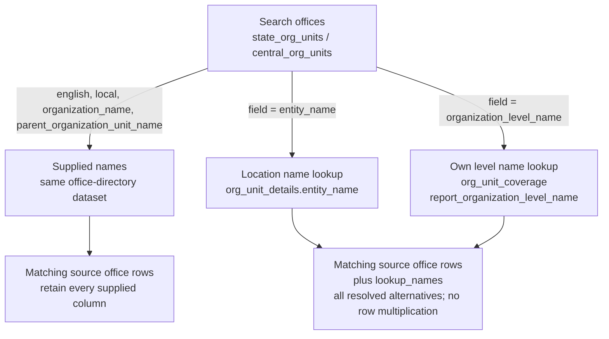

# Organization query cookbook

[Dataset index](datasets/README.md) · [Data model and diagrams](ORGANIZATION_DATA.md) · [Shared query options](QUERIES.md)

These APIs are [experimental](QUERIES.md#experimental-status).

| Question | Operation |
| --- | --- |
| Which location or coverage types occur? | `types`: counts from the source report only |
| Which offices/claims resolve, and which do not? | `references`: source rows, targets and resolution outcomes |
| Which places do the references identify? | `entities`: matched register records only |
| What location name does LGD report for an office? | `--include-entity-name`: directory rows enriched from details |

## An exploration sequence

```sh
lgd-query state_orgs search Revenue --state-code 32
lgd-query state_org_units list --organization-code 889
lgd-query org_unit_details code 1237173
lgd-query org_unit_details types --organization-code 889
lgd-query state_org_units references --organization-code 889 --entity-type 2
lgd-query org_unit_coverage code 1237173
```

For custom administration, find level definitions in `state_admin_depts`, then
query `state_admin_dept_units --help` for units at that level. Central reports
have corresponding datasets. Designations describe titles and level associations,
not people or appointments. Parent-office filters select direct children; missing
parents prevent inferring a complete hierarchy.

All examples select the current metadata generation. Reports within it can have
different dates; inspect provenance before interpreting missing matches.

## Inspect types before resolving references

`reference_types(db, **source_filters)` (CLI `types`) is available on the two
unit directories, details and coverage. It reads only that source, even when
target registers are unavailable. Different reported labels remain separate.

| Result columns | Meaning |
| --- | --- |
| `reference_type`, `reported_type_name` | Raw type and supplied label; directories lack labels |
| `known_type_name`, `target_datasets` | Known namespace and required registers; custom/unrecognized types may have no known label |
| `resolvable` | Namespace is known; a matching record need not exist |
| `source_rows`, `organization_units` | Report rows (including duplicates) and distinct offices, not distinct covered places |

`reference_type_map()` describes known namespaces without I/O. Details can
supply custom-level labels absent from directories. Types `0` and `-100` have
no invented official label. Unknown raw values remain filterable.

```sh
lgd-query org_unit_details types --state-code 32 --all
lgd-query org_unit_coverage types --coverage-details-reported true --all
```

## Follow entity references to registers

`entities` resolves typed codes on all four reports. Directories and details use
signed numeric location `entity_type` and `entity_code`:

| Location `entity_type` | Meaning | Register searched by `entity_code` |
| --- | --- | --- |
| `1` | State | `states.state_code` |
| `2` | District | `districts.district_code` |
| `3` | Subdistrict | `subdistricts.subdistrict_code` |
| `4` | Village | `villages.village_code` |
| `5` | Block | `blocks.block_code` |
| `-1` | District Panchayat | PRI, urban and traditional local-body registers, by `local_body_code` |
| `-2` | Intermediate Panchayat | The same local-body registers |
| `-3` | Village Panchayat | The same local-body registers |
| `-4` | Municipal Corporations | The same local-body registers |
| `-5` | Municipality | The same local-body registers |
| `-6` | Notified Area Council | The same local-body registers |
| `-7` | Town Panchayat | The same local-body registers |
| `-8` | Cantonment Board | The same local-body registers |
| Greater than `5` | Custom administrative-unit level | `*_admin_dept_units`, matching both `administrative_unit_level_code` and `administrative_unit_code` |
| `0`, `-100`, unrecognized negative values | Sentinel, international, or unrecognized type | No inferred register match |

Coverage instead uses textual `covered_entity_type` and `covered_entity_code`.
Supported labels are `State`, `District`, `Subdistrict`, `Village`, `Block` and
the eight local-body labels above. Spelling is exact: `SubDistrict` is invalid
here. Only claims with `coverage_details_reported='true'` select targets.
`entities` rejects unknown/sentinel type selections before I/O; `references`
retains them with an outcome. Neither infers custom levels from coverage labels.

Source filters select offices/claims. `state_code='0'` means central organization
scope, not a geographic state. Geographic joins use typed codes independently of
that scope. Custom-level joins require level and unit codes plus matching state
scope: central offices use central administrative units; state offices use state
units. An office's own `organization_level_code` is not its location type.

| Output | Interpretation |
| --- | --- |
| `entity_dataset`, `entity_type`, `entity_code`, `entity_name` | Resolved target; for coverage, these describe the covered place |
| Register columns | Every matched register field; absent columns in combined results are NULL |
| `reference_type_matches` | Local-body subtype agrees (`true`), differs (`false`) or is unavailable (`NULL`); geographic/custom matches are `true` |

Repeated references do not multiply results. Register variants—village categories,
block/district links or traditional parent paths—remain separate. Local bodies
share a code namespace, so all three body registers are searched regardless of
reported subtype. A subtype mismatch can reflect different source dates.

Unmatched, untyped, zero, blank or negative entity codes return no register row.
They remain available in source queries and `references`. Joins preserve string
leading zeros and never use names.

```sh
lgd-query state_org_units entities --entity-type 2 --organization-unit-code 1237173
lgd-query central_org_units entities --entity-type 1254
lgd-query org_unit_details entities --entity-type=-5 --state-code 32
lgd-query org_unit_coverage entities --covered-entity-type Village --coverage-type F
```

Use `queries.prepare` to keep dependencies and execution together. Direct callers
can use `required_entity_datasets(type_value)` and
`entity_sources(release, type_value, observed_on=None)`. For custom levels in
`org_unit_details`, pass the same `state_code` to dependency helpers and execution:
`"0"` needs central units, a nonzero state needs state units, and an unfiltered
query needs both. Explicit date guards apply to every input; unavailable required
registers fail rather than produce apparent missing matches.

## Keep offices, claims and unresolved references

`references(db, **source_filters)` keeps all source columns as `source_*` and
matched register columns as `target_*`. Filters use original unprefixed names.
Coverage follows `source_covered_entity_*`, retaining office-location
`source_entity_*` separately. `source_state_code` is organization scope;
`target_state_code` is the matched place's state.

Each source row yields one row per distinct target variant, or one row with NULL
targets if unresolved. Exact target duplicates collapse; source duplicates remain.

| `resolution_status` | Meaning |
| --- | --- |
| `matched` | One distinct matching register record |
| `ambiguous` | Several matching register records; all remain visible |
| `missing_type` | Reference type is NULL, empty or whitespace-only |
| `missing_code` | Reference code is NULL, empty or whitespace-only |
| `invalid_code` | Non-digit, zero or negative reference; no accidental namespace match |
| `unsupported_type` | No verified target namespace for the supplied type |
| `unmatched` | Known type and usable code, but no matching record in the loaded registers |
| `not_reported` | Coverage details were explicitly not supplied; this is not zero coverage |

When several problems apply, precedence is `not_reported`, missing type, missing
code, invalid code, unsupported type, then matching outcomes. `target_match_count`
counts distinct records; `target_name_count` counts distinct nonblank names.
Two village-category records can have one name. `target_dataset`, `target_code`
and `target_name` identify matches; `reference_type_matches` records body subtype
agreement. Ambiguity alone does not establish a source error.

```python
from lgd_query import load_release, connect, queries

query = queries.prepare(
    "org_unit_coverage", "references", covered_entity_type="Village",
    organization_code="1149", resolution_status="unmatched",
)
inputs = query.sources(load_release())
print([(d.name, d.observed_on, d.status) for d in inputs])
with connect(inputs, cache_dir="./data") as db:
    rows = query.execute(db).fetchall()
```

`resolution_status` filters after matching; ordinary filters and missing-value
predicates select source rows. A type filter narrows dependencies. Without it,
`references` needs every supported target register for the report. Unknown
coverage types and location sentinels need only the source. Missing required
registers fail explicitly. An unmatched target is not evidence of deletion.

Direct dependency helpers are `required_reference_datasets(reference_type=None,
state_code=None)` and `reference_sources(release, reference_type=None,
state_code=None, observed_on=None)`. Scope arguments are keyword-only; central
directories have no state-code filter.

```sh
lgd-query org_unit_coverage references --covered-entity-type Village --resolution-status unmatched --columns source_organization_unit_code source_covered_entity_code resolution_status
lgd-query org_unit_coverage references --covered-entity-type '' --resolution-status not_reported
lgd-query org_unit_details references --entity-type=-100 --provenance --format json
```

## Where the APIs get missing names

Most searches use supplied names. Office directories support two lookup fields:



| Search field | Source | Join conditions |
| --- | --- | --- |
| `entity_name` | `org_unit_details` | Same unit, organization, location code/type and state scope |
| `organization_level_name` | `org_unit_coverage` | Unit's own level equals `report_organization_level_code`; same organization and state scope |

Central directories join details/coverage scope `state_code='0'`; state
directories require equal state codes. Named coverage selections can include
descendants, so the selected level must not be assigned to every returned office.
Only levels present as named selections resolve. Designation reports cannot
supply this join for the 23 October 2026 release: all their level codes are blank.

Search adds `lookup_names` with resolved alternatives without multiplying office
rows. To include location names without searching them, pass
`include_entity_name=True` to `list`, `by_code` or `search` and its dependency
helper. The CLI loads details automatically with `--include-entity-name`.

| Added column | Meaning |
| --- | --- |
| `entity_names` | Sorted distinct nonblank details labels; `[]` when missing |
| `entity_name` | The unique label, otherwise NULL |
| `entity_name_status` | `matched`, `missing` or `ambiguous` |

All source rows remain; enrichment does not change search ranking or multiply
rows. Defaults omit these columns and the extra dependency. Labels are details
report claims; reference resolution does not replace them with register names.

```sh
lgd-query state_org_units search Alappuzha --field entity_name --state-code 32 --organization-code 889
lgd-query state_org_units code 1237173 --include-entity-name
```

## Filter reported location-name outcomes

State/central office queries accept exact `entity_name` and
`entity_name_status="matched"|"missing"|"ambiguous"` filters. These enable details
enrichment automatically, before search ranking and limits. Exact `entity_name`
matches only the unambiguous scalar; `search(field="entity_name")` can match any
alternative. `is_null="entity_name"` selects missing or ambiguous labels;
`is_blank="entity_name"` matches nothing because blank labels are excluded.

Status concerns details labels, not geographic verification. Use the same name
options in dependency helpers, or prepare the query once.

```sh
lgd-query state_org_units search Collectorate --state-code 32 --entity-name-status missing
lgd-query central_org_units list --entity-name-status ambiguous --columns organization_unit_code entity_names entity_name_status
```
